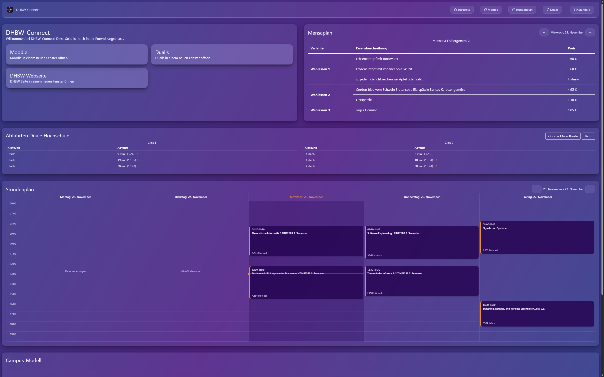

# DHBW-Connect

Alle DHBW-Services auf einen Blick: Stundenplan, Mensaplan, Abfahrten der Duale Hochschule sowie Links zu Dualis und Moodle, alles auf einer Seite.

Die App ist unter [xefili.github.io/dhbw-connect](https://xefili.github.io/dhbw-connect/#/) erreichbar.



## Funktionen

- **Mensaplan**: Speiseplan der Mensa Erzbergerstraße für den gewählten Tag, Tage ohne Angebot werden übersprungen.
- **Stundenplan**: Wochenansicht (Desktop) bzw. Tagesansicht (Mobil) mit Vorlesungen, Räumen und ausgefallenen Terminen.
- **Abfahrten**: Echtzeit-Abfahrten der KVV-Haltestelle „Karlsruhe, Duale Hochschule“, aktualisiert alle 30 Sekunden.
- **Campus-Modell**: Interaktives 3D-Modell des Campus (three.js), wird erst geladen, wenn es in den Sichtbereich scrollt.
- **Links**: Moodle, Dualis, DHBW-Webseite und Google-Maps-Route zur Hochschule.
- **Design-Themes**: 8 wählbare Farbschemata (Standard, Neon Sunset, Leibniz-Keks, Schoko-Keks, Erdbeertorte, Terminal, OLED, Blockwelt). Die Auswahl wird im Browser gespeichert.
- **Impressum** unter `#/legal`.

## Datenquellen

| Bereich       | Quelle                                                                 | Konfiguration                         |
| ------------- | ---------------------------------------------------------------------- | ------------------------------------- |
| Mensaplan     | GraphQL-API `https://mensa.xefili.app/graphql`                         | `CANTEEN_ENDPOINT`, `CANTEEN_ID`      |
| Stundenplan   | `https://mensa.xefili.app/events` (DHBW.app-Daten)                     | `TIMETABLE_ENDPOINT`                  |
| Abfahrten     | KVV-Schnittstelle `projekte.kvv-efa.de`                                | `KVV_ENDPOINT`, `KVV_STOP_ID`         |
| Campus-Modell | `public/dhbw.glb` (lokal im Repo)                                      | –                                     |

Alle URLs und IDs liegen zentral in `src/config.js`, die Navigation und Linkkarten in `src/data/links.js`.

## Voraussetzungen

- **Node.js 24 oder neuer** (siehe `.nvmrc` und `engines` in `package.json`). Mit `engine-strict=true` in `.npmrc` verweigert npm die Installation auf älteren Versionen.
- npm (wird mit Node.js installiert) und git

## Setup

```sh
git clone https://github.com/xefili/dhbw-connect
cd dhbw-connect
nvm use            # optional: liest .nvmrc (Node 24)
npm install
npm run dev        # Entwicklungsserver mit Hot Reload
```

## Skripte

| Befehl                  | Beschreibung                                                 |
| ----------------------- | ------------------------------------------------------------ |
| `npm run dev`           | Vite-Entwicklungsserver (inkl. Vue DevTools)                 |
| `npm run build`         | Produktionsbuild nach `dist/`                                |
| `npm run preview`       | Lokale Vorschau des Produktionsbuilds                        |
| `npm run format`        | Formatiert `src/` mit Prettier                               |
| `npm run format:check`  | Prüft die Formatierung, ohne Dateien zu ändern (CI-Schritt) |

Der Build nutzt die Basis-URL `/dhbw-connect/`, da die Seite unter GitHub Pages liegt. Bilder und Assets werden deshalb immer über `import.meta.env.BASE_URL` bzw. relativ eingebunden, nie mit einem festen `/…`-Pfad.

## Projektstruktur

```
.github/workflows/deploy.yml   CI: format-Prüfung, Build und Deployment auf GitHub Pages
public/                        Statische Dateien (Logo, Favicon, 3D-Modell)
src/
  main.js                      Einstiegspunkt
  App.vue                      Layout (Header, Seite, Footer)
  config.js                    Endpunkte, IDs und Konstanten
  themes.js                    Theme-Liste (Quelle für index.html und den Theme-Switcher)
  data/links.js                Navigation und Linkkarten
  router/index.js              Routen (Hash-Routing)
  composables/useTheme.js      Theme-Zustand und Speicherung
  utils/dates.js               Datums- und Zeithilfen (Zeitzone Europe/Berlin)
  styles/input.css             Tailwind-Konfiguration, Theme-Farben, Komponentenklassen
  components/                  UI-Bausteine (Mensa, Stundenplan, Abfahrten, 3D-Modell …)
  views/                       Seiten (Home, Impressum)
index.html                     Einstieg; wendet das gespeicherte Theme vor dem ersten Render an
vite.config.js                 Vite-Konfiguration (Vue, Tailwind, Theme-Injektion)
```

## Themes hinzufügen

1. Eintrag in `THEMES` in `src/themes.js` ergänzen (`id` und `label`).
2. Farbwerte als Selektor `:root[data-theme="<id>"]` in `src/styles/input.css` anlegen.

`index.html` übernimmt die Liste beim Build automatisch aus `src/themes.js`.

## Deployment

Jeder Push auf `main` startet die CI (`.github/workflows/deploy.yml`):

1. `npm ci` mit Node 24 (aus `.nvmrc`)
2. `npm run format:check`
3. `npm run build`
4. Veröffentlichung von `dist/` auf GitHub Pages

Pull Requests werden ohne Deployment geprüft.

## Hinweise

- Die Seite ist rein statisch. Ein eigener Server ist nicht nötig, solange keine geheimen API-Schlüssel benötigt werden.
- Impressum und Kontaktdaten stehen in `src/views/Impressum.vue`.

---

# Anhang: Fragen Blätter

## Blatt 3

1. Die Spezifikation des Selectors `element element` besitzt die Spezifikation `(0, 0, 2)`, der Selector `.klasse` besitzt `(0, 1, 0)` und ist daher höher gewichtet.
2. `rem` nutzt root-em Größen, also Schriftgröße nach Browserzoom. `px` ist eine statische Größe, welche immer gleich bleibt. Für Layouts, welche sich an verschiedene Browser anpassen müssen, sind relative Größen wie `rem` besser.
3. Das Element ist entweder nicht `position: absolute|fixed|static|sticky` oder das Elternelement ist nicht `position: relative`.

## Blatt 4

Der Header (Navbar), der Footer und Kärtchen sind Komponenten und nutzen daher auf allen Seiten das gleiche Design.

`dist/assets/index-CJ-aHc-V.css    7.55 kB │ gzip:  2.23 kB`
Tailwind compiliert nur benötigte Klassen und lässt nicht genutzten Whitespace aus, das geht manuell auch mit `--minify`. Vite komprimiert die Datei zusätzlich mit gzip.

1. `fr` steht für Fraction; `grid-template-columns: 1fr 3fr` erstellt ein Grid mit zwei Spalten, Spalte 2 ist 3x so groß wie Spalte 1.
2. Der Ordner enthält statische Dateien (Vue SPA). Der Ordner wird durch `.gitignore` nicht markiert. Das Repo enthält die Rohdateien, der `dist/` Ordner wird durch das Build-System von Github immer neu generiert. Dadurch spart man Platz und Teilnehmer müssen nicht immer neue Build Dateien hochladen oder erstellen.
3. Weil der Ordner zu groß ist und oft platformspezifische Dateien beinhaltet. `package-lock.json` definiert die benötigten Packages und die Versionen der Pakete.

## Blatt 5

### A1
Funktioniert.

### A2
Einige 4XX kommen von einer externen API welche noch geändert wird, werden daher ignoriert. Bilder und eigene Medien produzieren keine 404s.

### A3

1. Die Seite ist identisch.
2. Bestimmte relative Links auf den `assets/` Ordner werden in der `index.html` Datei nicht korrekt zugeordnet. Dateien müssen im `public/` Ordner liegen. Dateien im Asset-Ordner funktionieren nur in `*.vue` Dateien.
3. Joah, ist alles identisch.

### A5
Keine Schlüssel vorhanden.

### Bonus

Ein eigener Server ist notwendig, wenn API-Schlüssel und geheime Daten übertragen werden müssen. Unsere Seite benötigt diese noch nicht und funktioniert daher komplett statisch auf Github Pages.

### Verständnis

1. 200er sind Codes, welche bei erfolgreichen Anfragen gesendet werden. Bei 400er Codes liegt der Fehler an der Webseite, hier werden Dateien angefragt welche nicht existieren oder Anfragen werden falsch formuliert. Bei 500er hat der Server selbst einen Fehler, oft in der Anfragenbearbeitung.
2. Buildfehler (Buildsystem prüfen), Falsche Dependencies (Dependencies überprüfen), Keine Umgebungsvariablen (gibt es bei statischen Seiten oft nicht, brauchen ein http-server Backend)
3. Datei ist eine statisch geöffnete Seite, lokaler Server ist wie Hosting (fast identisches Umfeld), jedoch kann nur im lokalen Netzwerk darauf zugegriffen werden.
