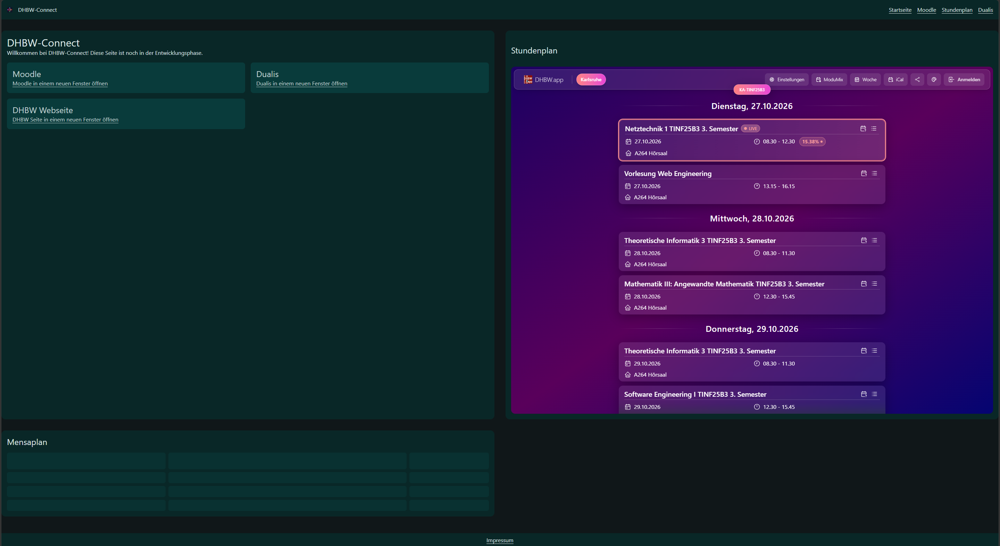

# DHBW-Connect

- Alle DHBW-Services auf einen Blick!
- Auf den ersten Blick können Stundenplan und Mensaplan eingesehen werden.
- Links zu Dualis und Moodle inklusive.

Die App ist unter [github.io/dhbw-connect](https://xefili.github.io/dhbw-connect/#/).

## Datenquellen

Die Daten kommen von der DHBW.app Seite. Mensadaten kommen demnächst.

## Setup

*Node.js, npm und git müssen installiert sein. Node.js muss mindestens auf Version 24 sein!*

1. `git clone https://github.com/xefili/dhbw-connect`
2. `npm install`
3. `npm run dev` (Live Server) oder `npm run build` (Produktionsbuild)

# Fragen Blätter

## Blatt 3

1. Die Spezifikation des Selectors `element element` besitzt die Spezifikation `(0, 0, 2)`, der Selector `.klasse` besitzt `(0, 1, 0)` und ist daher höher gewichtet.
2. `rem` nutzt root-em Größen, also Schriftgröße nach Browserzoom. `px` ist eine statische Größe, welche immer gleich bleibt. Für Layouts, welche sich an verschiedene Browser anpassen müssen, sind relative Größen wie `rem` besser.
3. Das Element ist entweder nicht `position: absolute|fixed|static|sticky` oder das Elternelement ist nicht `position: relative`.

## Blatt 4
Der Header (Navbar), der Footer und Kärtchen sind Komponenten und nutzen daher auf allen Seiten das gleiche Design.

`dist/assets/index-CJ-aHc-V.css    7.55 kB │ gzip:  2.23 kB`
Tailwind compiliert nur benötigte Klassen und lässt nicht genutzten Whitespace aus, das geht manuell auch mit `--minify`. Vite komprimiert die Datei zusätzlich mit gzip.

1. `fr` steht für Fraction; `grid-template-columns: 1fr 3fr` erstellt ein Grid mit zwei Spalten, Spalte 2 ist 3x so groß wie Spalte 1.
2. Der Ordner enthält statische Dateien (Vue SPA). Der Ordner wird durch `.gitignore` nicht markiert. Das Repo enthält die Rohdateien, der `dist/` Ordner wird durch das Build-System von Github immer neu generiert. Dadurch spart man Platz und Teilnehmer müssen nicht immer neue Build Dateien hochladen oder erstellen.
3. Weil der Ordner zu groß ist und oft platformspezifische Dateien beinhaltet. `package-lock.json` definiert die benötigten Packages und die Versionen der Pakete.

## Blatt 5

### A1
Funktioniert.

### A2
Einige 4XX kommen von einer externen API welche noch geändert wird, werden daher ignoriert. Bilder und eigene Medien produzieren keine 404s.

### A3

1. Die Seite ist identisch.
2. Bestimmte relative Links auf den `assets/` Ordner werden in der `index.html` Datei nicht korrekt zugeordnet. Dateien müssen im `public/` Ordner liegen. Dateien im Asset-Ordner funktionieren nur in `*.vue` Dateien.
3. Joah, ist alles identisch.

### A5
Keine Schlüssel vorhanden.

### Bonus

Ein eigener Server ist notwendig, wenn API-Schlüssel und geheime Daten übertragen werden müssen. Unsere Seite benötigt diese noch nicht und funktioniert daher komplett statisch auf Github Pages.

### Verständnis

1. 200er sind Codes, welche bei erfolgreichen Anfragen gesendet werden. Bei 400er Codes liegt der Fehler an der Webseite, hier werden Dateien angefragt welche nicht existieren oder Anfragen werden falsch formuliert. Bei 500er hat der Server selbst einen Fehler, oft in der Anfragenbearbeitung.
2. Buildfehler (Buildsystem prüfen), Falsche Dependencies (Dependencies überprüfen), Keine Umgebungsvariablen (gibt es bei statischen Seiten oft nicht, brauchen ein http-server Backend)
3. Datei ist eine statisch geöffnete Seite, lokaler Server ist wie Hosting (fast identisches Umfeld), jedoch kann nur im lokalen Netzwerk darauf zugegriffen werden.